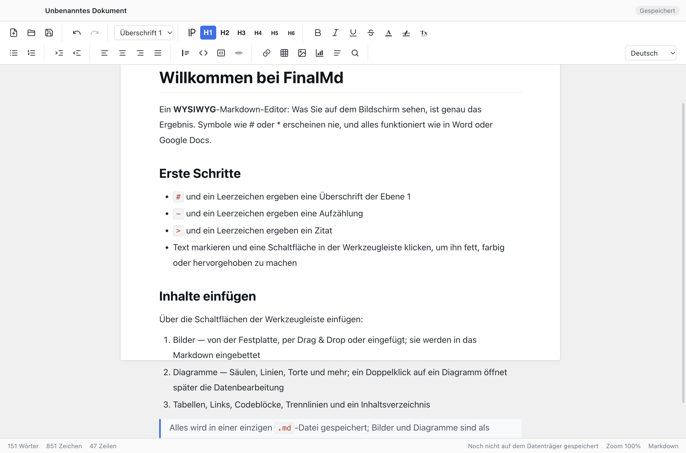
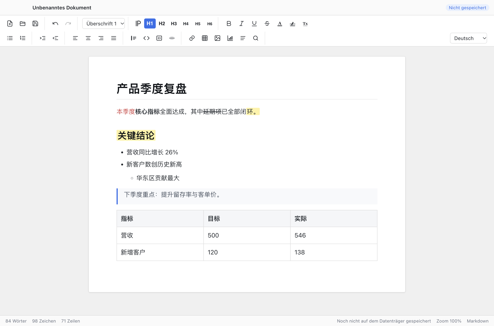

# FinalMd

**简体中文** · [English](#english)

当前版本 **v1.0.1** ｜ 变更记录见 [CHANGELOG.md](CHANGELOG.md)

FinalMd 是一个**所见即所得的 Markdown 桌面写作器**。用 Word / WPS 的方式写文章，保存出来的是标准 `.md` 文件。

输入 `# ` 立刻变成大标题、选中文字按工具栏按钮加粗变色——全程看不到 `**` 这样的 Markdown 符号；需要原始文件时，⌘S 保存出的就是干净的 Markdown 源码。



---

## 简体中文

### 简介

FinalMd 面向**不熟悉 Markdown 语法**的用户：你可以像用普通笔记软件一样写文档，文件却以 `.md` 格式保存——既顺手写作，又方便把文档喂给 AI agent。

### 背景

我是医疗器械领域的新创业者。与 AI agent 协作时，我需要给它投喂大量文档，而其中大部分并不是 `.md` 格式。于是我决定用 `.md` 来创建和保存文档，这样 AI agent 能更高效地理解我的指令。

我试过很多编辑器，大多无法满足需求，所以决定自己做一个。**所有代码均由 AI agent 生成。**

如果你对这个项目感兴趣，非常欢迎你的建议。

### 功能

**写作体验**
- 纯所见即所得，输入 Markdown 快捷语法即时渲染
- Word 风格功能区：段落样式下拉 + ¶ / H1~H6 快捷按钮、字体颜色、荧光笔、对齐、缩进、列表
- 六级标题（⌘1~⌘6，⌘0 回正文）
- 查找替换（⌘F）、字数 / 字符 / 行数统计、⌘+/- 缩放
- 白纸排版界面，未保存关闭提醒
- **界面多语言（7 种）**：简体中文 / English / 日本語 / 한국어 / Français / Deutsch / Español，工具栏右侧下拉随时切换，首次启动自动跟随系统语言

**插入内容**
- 图片：本地多选、拖拽进编辑区、⌘V 粘贴，自动内嵌为 base64；超过 380KB 自动压缩（最长边 1600px）
- 图表：内置图表引擎，支持柱状图 / 折线图 / 面积图 / 条形图 / 饼图，弹窗内编辑数据、切换配色、实时预览
- 插入后**双击图表可回来修改数据**——图表配置保存在图片 `title` 属性里，随 `.md` 文件一起走
- 表格、链接、分割线、代码块、自动生成目录（TOC）

**保存与导出**
- ⌘S 保存 / ⌘⇧S 另存为 `.md`
- 标题、加粗、列表、表格、代码块输出为标准 Markdown
- 颜色、高亮、对齐以 HTML 标签保留（兼容主流渲染器）
- 导出 HTML、导出 PDF（自动隐藏界面只打印正文）



### 运行

```bash
git clone https://github.com/xiaoxicode/FinalMd.git
cd FinalMd
npm install
npm start          # 开发运行
npm run smoke      # 冒烟测试（66 项）
npm run i18n       # 多语言词典一致性校验
```

### 打包发布

```bash
npm run dist               # 打包到 build/（macOS .app）
./scripts/publish-mac.sh   # 签名 + 公证 + 上传 Release（需配置 .env）
```

发布相关配置见 `.env.example` 与 `scripts/publish-mac.sh`。应用已接入 electron-updater，正式包会在启动时静默检查更新，用户确认后下载安装（有未保存文档时先引导保存）。

### 技术栈

Electron 45 + TipTap 3（ProseMirror）+ tiptap-markdown，构建用 esbuild。

渲染层被打包成自包含单文件，**最终 app 内不含 node_modules**，因此在代码签名与公证环节不会遇到原生模块签名不全的常见问题。

图表为自研 SVG 引擎（无第三方图表库），插入时转为 PNG 内嵌。

**多语言结构**：界面文案集中在 `shared/i18n/`（每种语言一个文件），主进程与渲染层共用同一份词典——原生菜单和系统对话框因此能和界面保持同一语言。新增一种语言只需添加词典文件并登记到 `shared/i18n/index.js`，再跑 `npm run i18n` 校验 key 与占位符是否对齐。

### 已知限制

- 文字对齐、字体颜色依赖 HTML 标签，在纯 Markdown 阅读器中可能失效
- 图片全部内嵌 base64，`.md` 文件体积偏大（换取单文件即可带走）

### 许可

[Apache License 2.0](LICENSE)（`Apache-2.0`）

Copyright © 2026 Cliff

允许商用、修改、分发与专利授权；分发时需保留版权声明、许可证副本，并保留 [`NOTICE`](NOTICE) 文件中的归属声明。

---

<a id="english"></a>

## English

### Introduction

Current version **v1.0.1** · see [CHANGELOG.md](CHANGELOG.md)

FinalMd is an editor designed specifically for users who are **unfamiliar with Markdown syntax**. You write documents just as you would in a standard note editor, and the files are saved in `.md` format — comfortable to write, and ready to feed straight into an AI agent.

Type `# ` and it becomes a heading; select text and hit a toolbar button to bold or color it — you never see `**`-style Markdown syntax. When you need the source, ⌘S writes clean Markdown.

### Background

I am a new entrepreneur in the medical device area. When I am working with AI agent, I need to feed it many documents, while most of the documents are not created in .md format. I decided to create and save my documents in .md format so that AI agent can understand my instructions more efficiently.

I tried many editors, while most of them can not meet my requirements, so I decided to create a customized editor. **All the codes are generated by AI agent.**

If you are interested in this project, I am very glad to learn your advices.

### Features

**Writing experience**
- True WYSIWYG — Markdown shortcuts render instantly as you type
- Word-style ribbon: paragraph style dropdown + ¶ / H1–H6 buttons, font color, highlighter, alignment, indent, lists
- Six heading levels (⌘1–⌘6, ⌘0 back to paragraph)
- Find & replace (⌘F), word / character / line count, ⌘+/− zoom
- Paper-like layout, with a warning when closing unsaved work
- **7 UI languages**: Simplified Chinese, English, Japanese, Korean, French, German and Spanish — switch from the ribbon; the first launch follows your system language

**Inserting content**
- Images: pick from disk, drag & drop, or ⌘V paste — embedded as base64; auto-compressed above 380KB (max edge 1600px)
- Charts: built-in engine supporting bar / line / area / horizontal bar / pie; edit data, switch palettes and preview live in a dialog
- **Double-click a chart to edit its data later** — the chart config is stored in the image's `title` attribute and travels with the `.md` file
- Tables, links, horizontal rules, code blocks, auto-generated table of contents (TOC)

**Saving & exporting**
- ⌘S save / ⌘⇧S save as `.md`
- Headings, bold, lists, tables and code blocks are written as standard Markdown
- Colors, highlights and alignment are preserved as HTML tags (widely supported by renderers)
- Export to HTML and to PDF (the UI is hidden and only the page is printed)


### Getting started

```bash
git clone https://github.com/xiaoxicode/FinalMd.git
cd FinalMd
npm install
npm start          # run in development
npm run smoke      # smoke tests (66 checks)
npm run i18n       # i18n dictionary consistency check
```

### Build & release

```bash
npm run dist               # package into build/ (macOS .app)
./scripts/publish-mac.sh   # sign + notarize + upload the Release (needs .env)
```

See `.env.example` and `scripts/publish-mac.sh`. The app ships with electron-updater: release builds check for updates silently at launch, download only after the user confirms, and ask to save unsaved work before installing.

### Tech stack

Electron 45 + TipTap 3 (ProseMirror) + tiptap-markdown, bundled with esbuild.

The renderer is bundled into a self-contained single file, so **the final app contains no node_modules** — which avoids the usual notarization failures caused by unsigned native modules.

Charts are a hand-written SVG engine (no third-party chart library), rasterized to PNG on insert.

**i18n layout**: all interface strings live in `shared/i18n/` (one file per language) and are shared by the main process and the renderer, so native menus and system dialogs speak the same language as the UI. Adding a language means adding one dictionary file, registering it in `shared/i18n/index.js`, and running `npm run i18n` to verify keys and placeholders line up.

### Known limitations

- Text alignment and font color rely on HTML tags and may be lost in plain Markdown viewers
- All images are inlined as base64, so `.md` files get large (the trade-off for one self-contained file)

### License

[Apache License 2.0](LICENSE) (`Apache-2.0`)

Copyright © 2026 Cliff

Commercial use, modification, redistribution and a patent grant are all permitted. If you redistribute this software, you must keep the copyright notice and a copy of the license, and retain the attribution in the [`NOTICE`](NOTICE) file.
